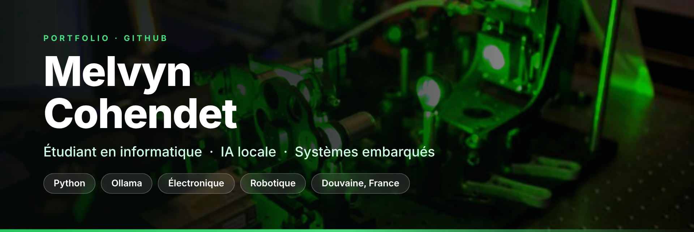
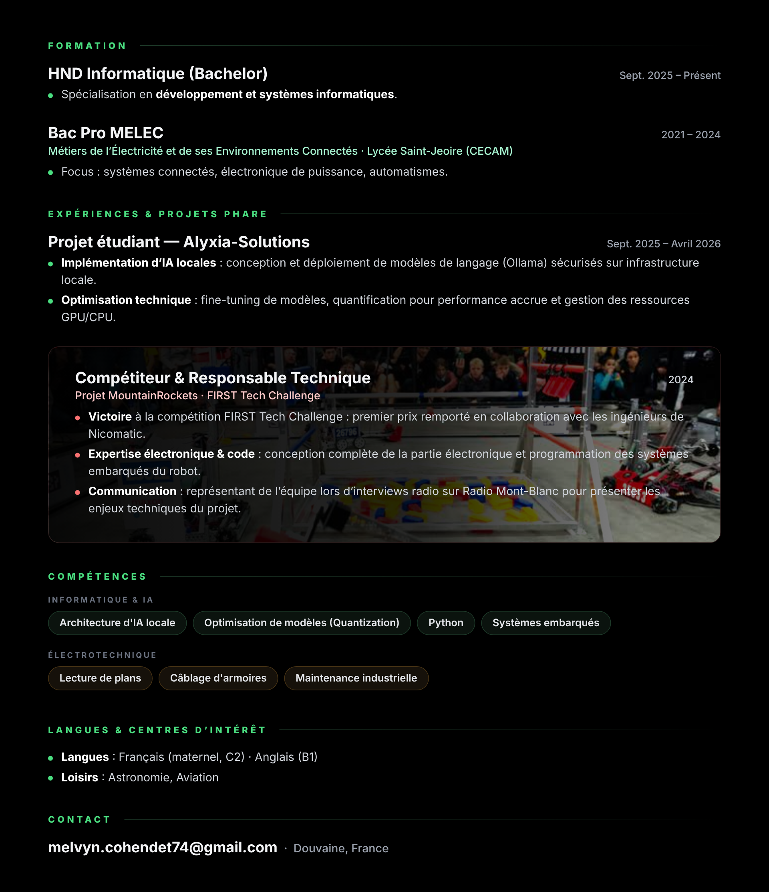

📫 [melvyn.cohendet74@gmail.com](mailto:melvyn.cohendet74@gmail.com) · 📍 Douvaine, France

Version texte

**Formation**
- HND Informatique (Bachelor), sept. 2025 – présent : développement et systèmes informatiques
- Bac Pro MELEC, Lycée Saint-Jeoire (CECAM), 2021 – 2024 : systèmes connectés, électronique de puissance, automatismes

**Expériences & projets phare**
- Alyxia-Solutions (sept. 2025 – avr. 2026) : IA locales avec Ollama, fine-tuning, quantification, gestion GPU/CPU
- MountainRockets, FIRST Tech Challenge (2024) : premier prix avec les ingénieurs de Nicomatic, électronique et programmation embarquée du robot, interviews sur Radio Mont-Blanc

**Compétences** : architecture d'IA locale, optimisation de modèles (quantization), Python, systèmes embarqués, lecture de plans, câblage d'armoires, maintenance industrielle

**Langues** : français (maternel, C2), anglais (B1) · **Loisirs** : astronomie, aviation

